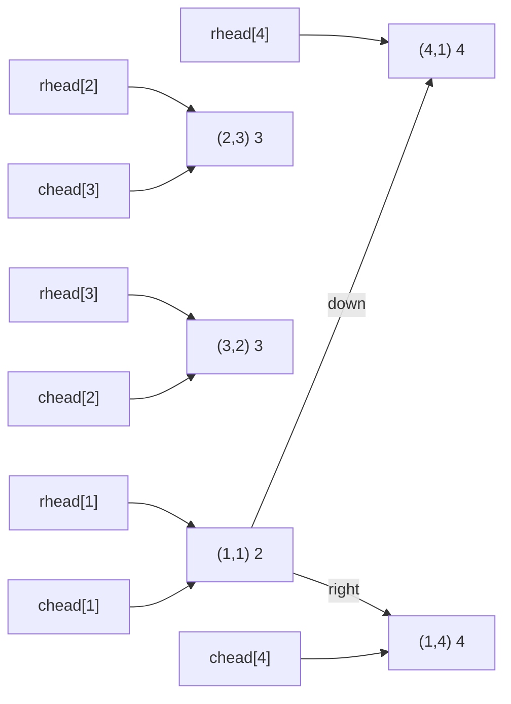

第二题

设对称矩阵 A（4 阶）为：

```
        | 2  0  0  4 |
   A =  | 0  0  3  0 |
        | 0  3  0  0 |
        | 4  0  0  0 |
```

即 a11=2，a14=a41=4，a23=a32=3，其余元素为 0，满足 a_ij = a_ji。

## (1) 按对称矩阵压缩存储

n 阶对称矩阵只需存下三角（含对角线）的 n(n+1)/2 个元素，这里 n=4，
共 4×5/2 = 10 个元素，按「行优先」存入一维数组 sa[1..10]。

存储表：

| k | 1 | 2 | 3 | 4 | 5 | 6 | 7 | 8 | 9 | 10 |
|:---|:-:|:-:|:-:|:-:|:-:|:-:|:-:|:-:|:-:|:-:|
| 对应元素 | a11 | a21 | a22 | a31 | a32 | a33 | a41 | a42 | a43 | a44 |
| sa[k] | 2 | 0 | 0 | 0 | 3 | 0 | 4 | 0 | 0 | 0 |

所以

```
   sa = ( 2, 0, 0, 0, 3, 0, 4, 0, 0, 0 )
          k=1 2  3  4  5  6  7  8  9  10
```

原来 4×4 = 16 个存储单元，压缩后只需 10 个，节省 6 个（37.5%）。

注意：对称矩阵压缩只利用「对称」这一性质，并不判断元素是否为 0，
所以 sa 中仍然保留了 7 个值为 0 的元素（a21、a22、a31、a33、a42、a43、a44）。

### 如何存取 a_ij（1 <= i, j <= 4）

下三角按行存放时，a_ij 之前共有 i-1 行，第 r 行有 r 个元素，
所以 a_ij（i >= j）的存储位置为

```
   k = 1 + 2 + ... + (i-1) + j = i(i-1)/2 + j
```

当 i < j 时，利用对称性 a_ij = a_ji，先交换 i、j 再用同一公式：

```
   k = j(j-1)/2 + i
```

合起来（记 row = max(i,j)，col = min(i,j)）：

```
   下标计算：  k = row*(row-1)/2 + col
   取值：      a_ij = sa[k]
   赋值：      sa[k] = x   即完成了 a_ij 与 a_ji 的同时修改
```

于是元素的存取时间是 O(1)，与矩阵规模无关。

验证几个：

- a11：k = 1×0/2 + 1 = 1，sa[1] = 2 ✔
- a32：k = 3×2/2 + 2 = 5，sa[5] = 3 ✔
- a23：i < j，k = 3×2/2 + 2 = 5，sa[5] = 3 ✔（与 a32 同一单元，正体现了对称性）
- a41：k = 4×3/2 + 1 = 7，sa[7] = 4 ✔
- a14：i < j，k = 4×3/2 + 1 = 7，sa[7] = 4 ✔

## (2) 按稀疏矩阵存储：十字链表

A 中非零元素只有 5 个：a11=2、a14=4、a23=3、a32=3、a41=4，
稀疏因子 δ = 5/16 ≈ 0.31，可以按稀疏矩阵处理。

十字链表的结点结构（与课件一致）：

```
   +------+------+------+--------+-------+
   |  i   |  j   |  v   |  down  | right |
   +------+------+------+--------+-------+
     行号   列号   值    同列下一个  同行下一个
```

另有 m 个行头结点 rhead[1..m]（right 指向本行第一个非零元）和
n 个列头结点 chead[1..n]（down 指向本列第一个非零元），共 4+4 = 8 个头结点。

5 个非零元结点记为：

```
   N11 = (1,1,2)   N14 = (1,4,4)   N23 = (2,3,3)
   N32 = (3,2,3)   N41 = (4,1,4)
```

按行序、同行按列序插入后，各条链如下。

行链（沿 right 指针）：

| 行 | 链 |
|:---|:---|
| rhead[1] | → N11(1,1,2) → N14(1,4,4) → NULL |
| rhead[2] | → N23(2,3,3) → NULL |
| rhead[3] | → N32(3,2,3) → NULL |
| rhead[4] | → N41(4,1,4) → NULL |

列链（沿 down 指针）：

| 列 | 链 |
|:---|:---|
| chead[1] | → N11(1,1,2) → N41(4,1,4) → NULL |
| chead[2] | → N32(3,2,3) → NULL |
| chead[3] | → N23(2,3,3) → NULL |
| chead[4] | → N14(1,4,4) → NULL |

结构示意图（箭头标注 right / down）：



等价的文本画法（每个结点画成一条「行向右、列向下」的十字）：

```
        chead[1]      chead[2]      chead[3]      chead[4]
           |             |             |             |
           v             v             v             v
        +--------+    +--------+    +--------+    +--------+
        | 1 1  2 |    | 3 2  3 |    | 2 3  3 |    | 1 4  4 |
        +--------+    +--------+    +--------+    +--------+
           |             |             |             |
           v             v             v             v
        +--------+      NULL          NULL          NULL
        | 4 1  4 |
        +--------+
           |
          NULL

   行链：rhead[1]→(1,1,2)→(1,4,4)→NULL   rhead[2]→(2,3,3)→NULL
         rhead[3]→(3,2,3)→NULL           rhead[4]→(4,1,4)→NULL
   列链：chead[1]→(1,1,2)→(4,1,4)→NULL   chead[3]→(2,3,3)→NULL
         chead[2]→(3,2,3)→NULL           chead[4]→(1,4,4)→NULL
```

### 两种存储方式的比较

| 方式 | 存储量 | 优点 |
|:---|:---|:---|
| 对称矩阵压缩（sa[1..10]） | 10 个元素 | 存储最省，a_ij 随机存取 O(1)，适合元素基本都非零的对称矩阵 |
| 十字链表 | 5 个元素结点 + 8 个头结点 = 13 个结点 | 能按行/列快速定位，插入删除只需改指针，适合稀疏且动态变化的矩阵 |

本题的非零元占比约 31%，压缩存储（10 个元素）反而比十字链表（13 个结点）
更省空间；但当非零元个数 t 远小于 n^2 时（例如 t < 2n），十字链表的优势才体现出来。
另外，用十字链表做 A + B、A^T 这类稀疏运算时，可以直接按行链或列链遍历，
不必像三元组表那样整体重排，这也是它存在的意义。
